<div align="center">
  
  <h1>ApiGo</h1>
  <p><strong>基于 MyGo 原生 UI（Go 直接自绘界面，无 HTML/JS/WebView）的跨平台接口调试工具</strong></p>
  <p>原生 GPU 渲染 · 单二进制分发 · 秒开低占用 · 主题跟随系统 · 视图可离屏测试</p>
  <p>
    <a href="#tech"></a>
    <a href="#tech"></a>
    <a href="#features"></a>
    <a href="#install"></a>
    <a href="#status"></a>
    <a href="LICENSE"></a>
  </p>
  <p>
    <a href="#about">项目说明</a> ·
    <a href="#features">核心特性</a> ·
    <a href="#shots">界面截图</a> ·
    <a href="#status">项目现状</a> ·
    <a href="#install">安装</a> ·
    <a href="#start">快速开始</a> ·
    <a href="#dev">开发与构建</a> ·
    <a href="#config">配置</a> ·
    <a href="#structure">目录结构</a> ·
    <a href="#roadmap">Roadmap</a> ·
    <a href="#license">开源协议</a>
  </p>
</div>

<a id="about"></a>
## 📖 项目说明

ApiGo 是一个用 Go 编写、由 MyGo 原生 UI 直接绘制的接口调试工具，形态对标 Hoppscotch：先建集合，再在集合里建接口（REST / GraphQL / WebSocket / SSE / Socket.IO / MQTT），接口标签归属于创建它的集合；集合自带「本地 / 测试 / 生产」三个环境和 BaseURL 变量。界面与逻辑都是 Go，没有前端构建链和浏览器运行时——单文件分发、启动即用、完全离线。

使用流程：没有集合时停在「主窗口」，列出全部集合并引导新建；新建后集合出现在顶部集合标签上，点开进入该集合——左侧搜索接口，用每行行尾的 `+` 菜单新建文件夹或接口，右侧请求与响应，右上角切换环境。集合、接口与环境都以本地 YAML 保存。开发与协作规则见 `AGENTS.md`。

<a id="status"></a>
## 📌 项目现状

> [!IMPORTANT]
> 界面按「集合 → 接口」的工作流分阶段复刻，还原口径与已知差异见 [`docs/design-baseline.md`](docs/design-baseline.md)。REST 与 WebSocket 链路完整可用；GraphQL/SSE/Socket.IO/MQTT 目前只建接口与开标签，执行按 [Roadmap](#roadmap) 推进。

| 能力 | 现状 |
|---|---|
| 原生 UI 单窗口（自绘界面，无 WebView） | 已实现：`internal/app/view.go`（`app.view`）+ `internal/app/run.go` |
| 窗口尺寸与位置记忆 | 已实现：`mygo.WindowOptions.StateKey` |
| 布局：集合标签条 40 / 左侧接口树 264（铺满高，可从状态栏最左侧折叠）/ 右侧请求面板（顶部请求页签 40 + 请求-响应分栏）/ 状态栏 32 | 已实现：`internal/app/view.go`、`internal/app/view_topbar.go`、`internal/app/view_tabs.go`、`internal/app/view_requests.go` |
| 集合：顶部标签切换、关闭（先弹窗确认）、右键弹出应用自绘菜单（关闭集合/关闭其他集合）、`…` 里重开最近关闭的集合 | 已实现：`internal/app/view_topbar.go` + `internal/app/view_menu.go` + `internal/app/view_confirm.go` |
| 接口树：「根目录」（集合自己的目录）行尾是「筛选」与「新建」菜单（新建文件夹 + 六种接口类型），**根目录没有「⋮」**（没有可重命名/移动/删除的东西），子文件夹与叶子接口按层缩进、可折叠；**非 REST 接口只显示类型图标，不显示类型名**；搜索与类型筛选；整行即按钮、整行手型指针；行悬浮换底色，当前激活标签页对应的接口行用主题色标出（草稿标签没有落盘位置，不点亮）；子文件夹与接口行尾（`+` 之后）的竖向「⋮」按钮打开行菜单（其余 more 菜单仍横向），右键不再弹：接口有 `重命名 / 复制接口 / 移动接口 / 删除接口`，文件夹有 `重命名 / 移动文件夹 / 删除文件夹`，删除项警示红字、删除前弹窗确认（真实删除文件与目录），移动与重命名走文件夹/命名弹窗 | 已实现：`internal/app/view_requests.go` + `internal/app/view_menu.go` + `internal/store/service_tree.go` + `internal/store/service_move.go` |
| 主窗口：有集合时头部「导入集合」（占位）+「新建集合」（弹窗输入名称）与集合列表（图标 + 名称 + 接口数 + `打开` + 行尾 `…` 自绘菜单：打开文件夹 / 打开集合 / 重命名集合 / 删除集合；**名称占满剩余宽度**，窄窗口才在按钮前省略，名称旁不再标 HTTP；**监听 `collections/` 目录**：目录被其他程序删掉的集合仍留在列表里，灰显 + 中划线、`打开` 变灰，点它或双击行弹出「集合不存在」确认，确认后只从列表移除；删除先弹窗警示，确认后只从列表移除、文件夹保留）；无集合时只显示居中引导与「新建集合 / 从集合文件导入」 | 已实现：`internal/app/view_home.go` + `internal/app/view_confirm.go` + `internal/store/service_hidden.go`（打开文件夹经 `mygo.Shell.OpenPath`） |
| 集合重命名：改名同时重命名集合目录，`.env/`、接口文件与 `apigo.yaml` 一起搬，已打开的集合与标签跟到新 id | 已实现：`store.renameCollection` + `app.renameCollection` |
| 新建接口：REST / GraphQL / WebSocket / SSE / Socket.IO / MQTT 六类，先开草稿标签（默认不落盘），`Ctrl+S` 时在弹窗里改名并选存放的文件夹再写成 `<接口名>.yaml`（默认位置就是按下 `+` 的那个）；标签标题后的灰点表示未保存；新建文件夹弹窗只问名称，同一层级不允许重名 | 已实现：`internal/app/view_requests.go` + `internal/app/app_tree.go` + `internal/app/view_picker.go` |
| 请求标签：每个集合独立的一组标签，新建/切换/关闭/复制/重命名（右键弹出应用自绘菜单）；一个接口只有一个标签，再次打开只把它切到前面；**「+」先弹出类型菜单**（REST/GraphQL/WebSocket/SSE/Socket.IO/MQTT，没有「新建文件夹」），选完才开对应类型的草稿标签；非 REST 的标签只显示类型图标、不显示类型名；单个标签最宽 260、超长标题省略，标签条隐藏滚动条但可滚动；右端只有环境选择器（原来的眼睛按钮已移除）；**集合刚打开时没有任何标签，连标签条都不画**，请求区只显示「开始提示面板」（标题 + 说明 + 四行动作与按键，动作名共用一列、整块左对齐），打开或新建接口才出现标签条与请求面板，关掉最后一个标签又回到提示面板 | 已实现：`internal/app/view_tabs.go` + `workspace` |
| 环境：集合自带「本地 / 测试 / 生产」，各含 `BaseURL`；支持新建、删除、改名、激活。选择器的下拉用主题色打勾 + 高亮标记激活的环境；管理弹窗两栏（左列表 / 右编辑，高 560），列表里点一行即激活并切到它编辑（打勾跟随），环境变量一行一个（变量名 + 值 + 警示色删除图标），没有「添加行」；底部 `取消` / `保存`（保存按钮为主题色），改名、切激活、增删改变量都只改内存，点保存才一次写盘，取消或 Esc 全部退回 | 已实现：`internal/store/service_env.go` + `internal/app/view_env.go` |
| 变量替换：`{{name}}` 用于 URL/参数/请求头/请求体；未解析则拒绝发送 | 已实现：`internal/store/vars.go` + `app.send` |
| 持久化：一个集合一个目录（`apigo.yaml` + `.env/` + `static/` + 每个接口一个 YAML），原子写入；写到一半的文件等在集合根目录的 `.tmp/` 里，崩溃残留的在打开集合时清掉 | 已实现：`internal/store/service_store.go`、`internal/store/service_tree.go`、`internal/store/service_env.go`（`gopkg.in/yaml.v3`）、`internal/store/service_yaml.go` |
| 文件同步：打开集合时整份重读；之后用 `mygo.WatchFiles` 递归监听集合目录（150ms 去抖），外部改了文件立刻刷新树表（接口没了的标签退回草稿），`.env`、`static` 与点开头的目录不监听 | 已实现：`internal/store/service_reload.go` + `internal/app/app_watch.go` |
| 接口写回：切换 / 新建 / 复制 / 关闭标签与关闭集合时，把当前标签写回它的接口文件，`Ctrl+S` 随时手动保存，写失败会提示；标签重命名会连接口文件一起改名 | 已实现：`app.saveTab` + `app.saveCurrent` + `store.updateRequest` |
| 请求行：方法下拉（彩色）、URL、**`发送` 与 `保存` 两个按钮都是「图标 + 文字」**（发送 = 纸飞机、主题色底；保存 = 软盘、**无底色**的次要按钮，点击等同 `Ctrl+S`）、`Ctrl+Enter`；**请求进行中 `发送` 变成「取消」**（仍是主题色、图标+文字），点它中止请求，面板显示「请求已取消」并可重试 | 已实现：`internal/app/view_request.go`（`iconButton`）+ `internal/app/app.go`（`cancelSend`/`saveCurrent`） |
| 参数 / 请求头 键值编辑（增删、启用开关、末尾自动空行——没有「添加行」按钮，在新行里输入即可、窄栏紧凑模式）；请求子页签为 `参数` / `请求头` / `请求体`，**打开接口时自动切到第一个有配置数据的页签**（参数 → 请求头 → 请求体，都没有就停在参数），Authorization / Pre-request / Scripts / Tests 暂不显示 | 已实现：`internal/widgets/kvlist.go` + `internal/app/view_request.go` |
| 请求体：格式胶囊一行选（`none` / `form-data` / `x-www-form-urlencoded` / `JSON` / `XML` / `Text` / `Binary` / `GraphQL` / `msgpack`），右端显示该格式的 Content-Type 与必填星号；JSON/GraphQL/XML/Text 走代码编辑器（高亮、行号、JSON 校验、魔杖「美化」），两个表单格式用键值表并按 `multipart` / urlencoded 发送；Binary、msgpack 需要选文件（暂未实现） | 已实现：`app.bodyFormats` + `internal/app/view_request.go` + `internal/req/http.go` |
| form-data 文件上传：字段值可以是文本或文件，`选择文件` 打开系统文件对话框，文件复制进集合的 `static/<日期>/<sha256>`，值列显示文件胶囊与原始文件名的文本；换文件 / 清除 / 删行会删掉旧文件，接口文件记相对路径与原始名 | 已实现：`internal/store/service_static.go` + `app.pickFormFile` + `internal/widgets/kvlist.go`（`internal/app/run.go` 的 `chooseUpload`） |
| 响应：状态码/耗时/大小；**右上角四个页签**——`预览`（页签名随正文类型变：JSON / 图像 / 视频 / 音频 / XML / 文本 / 文件，无响应时为「响应」）、`原始内容`（正文原样，只读代码视图，二进制给一行说明）、`响应头 N`、`请求头 N`（两列表格：名称小写 + 值，可选中复制）；**预览按 Content-Type 自动选择展示方式**——JSON（或正文能按 JSON 解析）用代码编辑器只读渲染并按两空格缩进；图片解码后就地显示（含像素尺寸与类型）；音频带播放器（播放/暂停、进度、时长，WAV 内置，MP3/Ogg 已注册解码器）；视频与其它二进制显示为文件卡；**meta 栏右端（耗时与大小之后）的下载图标**点开系统的文件夹选择窗口，默认落在系统下载目录，确认后把原始字节按推导出的文件名（同名编号 `名字 (2).ext`）存到所选目录，取消则什么都不写；文件名优先取 `Content-Disposition`，其次 URL 末段，最后按类型补扩展名；错误态与重试 | 已实现：`internal/app/view_response.go` + `internal/app/view_response_tabs.go` + `internal/app/view_response_media.go` + `internal/app/response_body.go` + `internal/app/response_media.go` + `internal/req/http.go`（`Response.Raw`） |
| 网络执行：**每个请求在自己的 goroutine 里跑**（网络、位图解码、JSON 美化都在后台），只有结果经 `Window.Update` 回窗口线程赋值——某个请求一直不返回只占住它自己的标签页，界面与其它接口照常；响应体上限默认 100 MB（设置里可改，1–10240 MB）、30 s 超时 | 已实现：`internal/app/app.go`（`send`/`apply`）+ `internal/app/response_media.go`（`prepareResponse`）+ `internal/req/http.go`（可取消） |
| 外观：跟随系统（启动时取桌面亮暗）/ 浅色 / 深色 / 纯黑，窗口主题与控件配色都由 app 下发 | 已实现：`app.themeFor` + `internal/design.Theme` |
| 设置：右上齿轮打开的弹窗，分「通用（语言 简体中文、响应体上限 MB、更新）/ 主题（背景四选一 + 9 种强调色）/ 数据（数据目录含更换/打开、版本）」三段；响应体上限默认 100 MB，1–10240 之间，改完即写入 `settings.yaml` | 已实现：`internal/app/view_env.go` + `internal/design/accent.go` + `internal/app/app.go`（`responseLimit`） |
| 自动更新：**默认不开启**；打开后启动时查 GitHub 最新 Release（草稿与预发布跳过），有新版本弹窗问是否打开下载页；设置里也能手动「检查更新」，结果显示在按钮旁（「已是最新版本 x.y.z」/「有新版本 x.y.z」/「检查更新失败：原因」），开关与结果都写进 `settings.yaml` 的 `autoUpdate` | 已实现：`internal/app/update.go`（GitHub API + 版本比较）+ `update_check.go`（检查与提示）+ 设置「通用 → 更新」 |
| 界面字体：内嵌 HarmonyOS Sans SC 并默认启用，等宽场景用系统 monospace | 已实现：`internal/assets/font.go` + `design.FontFamily` |
| **WebSocket 请求**：地址 + `连接`/`断开`（图标+文字、主题色底，连接中显示「连接中…」）+ `保存`（图标+文字、无底色带边框）；`通讯` 页签给消息编辑器（格式下拉 Text/JSON/XML/HTML/Binary，**默认 JSON**，下拉宽度与触发器一致、当前项用主题色标出，换格式时编辑器的语法与占位提示一起换；`清空输入` 复选框与图标化的 `发送`——无底色带边框、比主按钮小一级，未连接或二进制时禁用）；`协议` 页签给子协议与握手请求头；下半屏是 `日志`：每条**可收缩/展开**，收缩显示 `状态符 + 一行摘要（空白折叠成一行，宽度随窗口自适应，只在真正放不下时按行宽省略）+ 行尾两列：先大小（定宽 52）后时间（定宽 60），都右对齐`；头部右端是 `过滤日志` 输入框（按消息内容包含匹配，计数变成 `M / N 条`，无命中给提示），行悬浮铺底色，点开用只读 code 渲染完整内容（字号比编辑器默认小一号，JSON 自动探测、按两空格缩进排版后高亮），`清空` 可清，**断开连接自动清空日志**；子协议与消息都随接口文件落盘 | 已实现：`internal/ws` + `internal/app/{view_websocket,socket}.go` |
| 非 REST 接口的执行（GraphQL/SSE/Socket.IO/MQTT） | 未实现（打开显示占位） |
| JSON 折叠树、请求头/响应头的搜索、集合导入导出 | 未实现 |
| 视图离屏测试与截图 | 已实现：`internal/app/main_test.go`、`internal/store/collections_test.go` 断言行为，`internal/app/shot_test.go` 出 PNG |

<a id="features"></a>
## ✨ 核心特性

### ⚡ 原生渲染，没有前端

界面由 Go 直接构建、由 GPU 绘制（Windows Direct3D 11 / macOS Metal / Linux OpenGL），窗口不启动 WebView：没有 HTML、没有 JavaScript、没有前端构建链，启动即出画面，内存占用远低于 Electron 类工具。

### 📦 单二进制，处处可跑

`go tool mygo build` 产出各平台可执行文件，Windows 附带 NSIS 安装包，macOS 附带 `.app`/`.dmg`，Linux 附带 deb 与 tar.gz；同一份代码也能编译成浏览器上运行的 WebAssembly 版本。

### 🎨 与系统一致的控件

请求方法下拉、多行 Body 编辑器、集合树、标签页、对话框等全部使用 MyGo 组件，键盘导航、焦点、禁用态与无障碍语义由框架负责；配色跟随桌面亮暗主题。

### 🧪 界面可当单元测试跑

视图是 `func(c *ui.Context)`，`ui.NewTester` 能在没有窗口的情况下点击、输入、断言文本，按 L1 回归成本维护布局与交互。请求执行放在 goroutine，结果经 `Window.Update` 回主线程。

<a id="shots"></a>
## 📸 界面截图

截图由离屏渲染产出（`APIGO_SHOTS=docs/shots go test -run TestShots ./internal/app/`），存在 `docs/shots/`，与当前代码同步。

| 主窗口：集合列表 | 请求与响应：接口树 + 请求页签 + JSON 预览 |
|---|---|
| 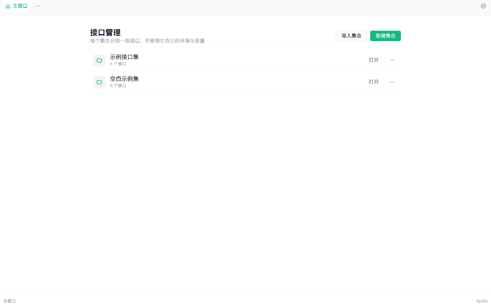 | 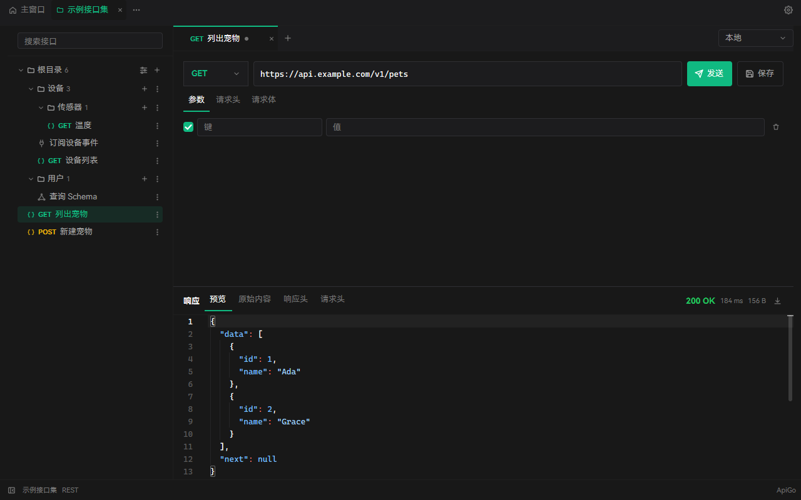 |

| 响应头表格 | 响应是图片时直接显示 |
|---|---|
| 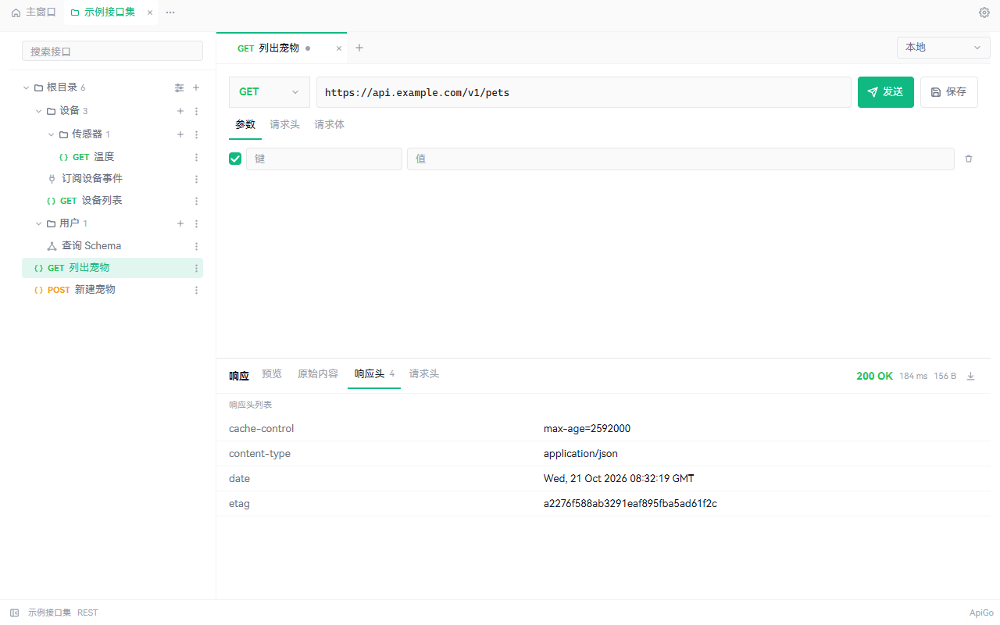 | 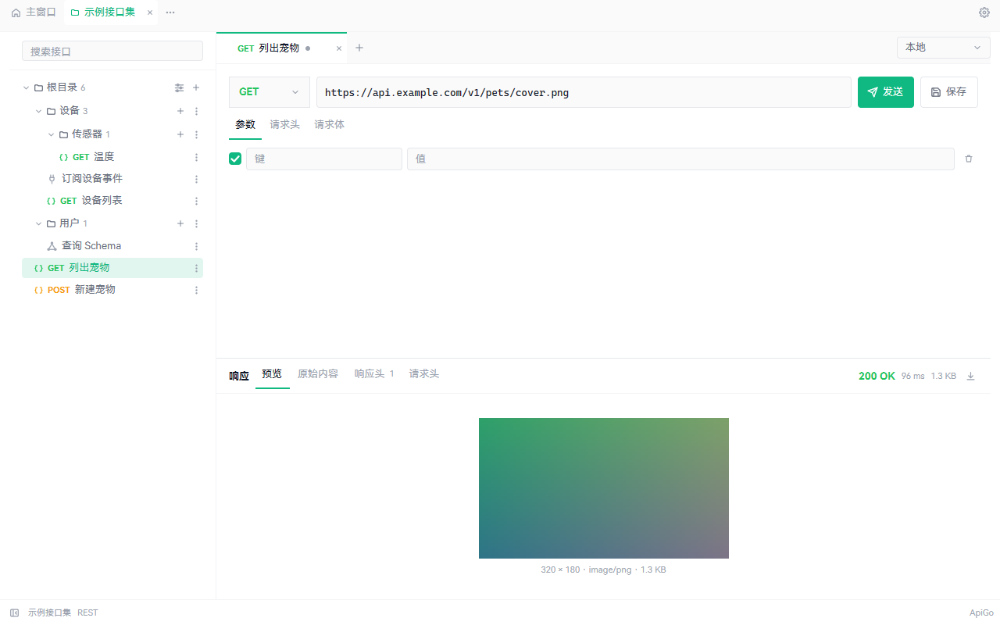 |

| 环境管理：左列表右变量编辑 | 设置：语言 / 响应体上限 / 主题 / 数据目录 |
|---|---|
| 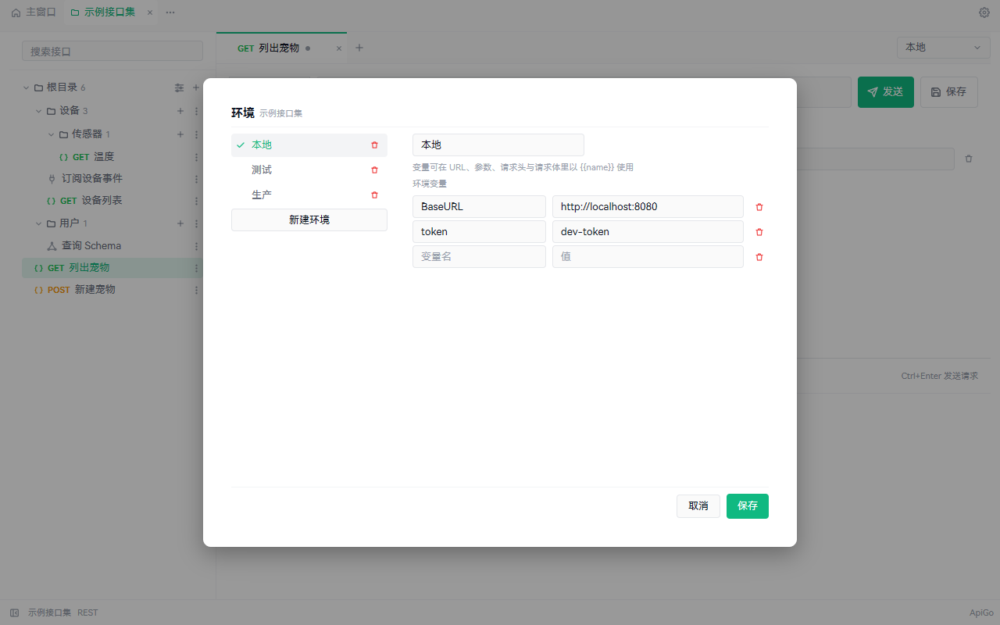 | 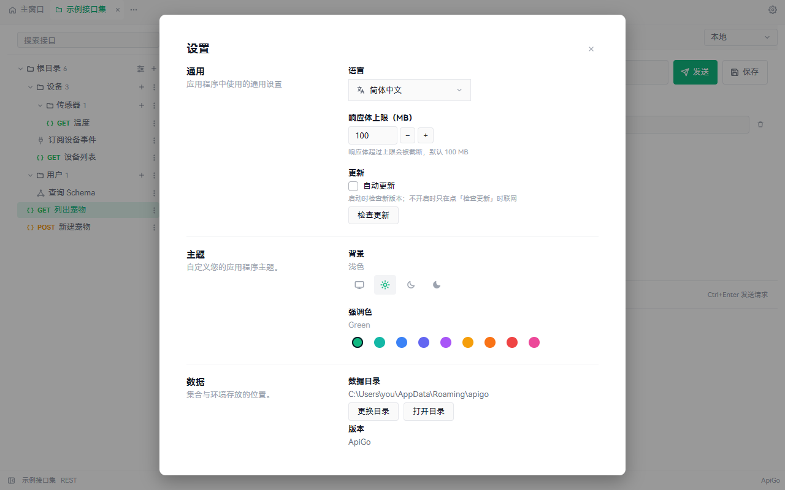 |

| WebSocket：连接、消息与收发日志 | WebSocket 协议页：子协议与握手请求头 |
|---|---|
| 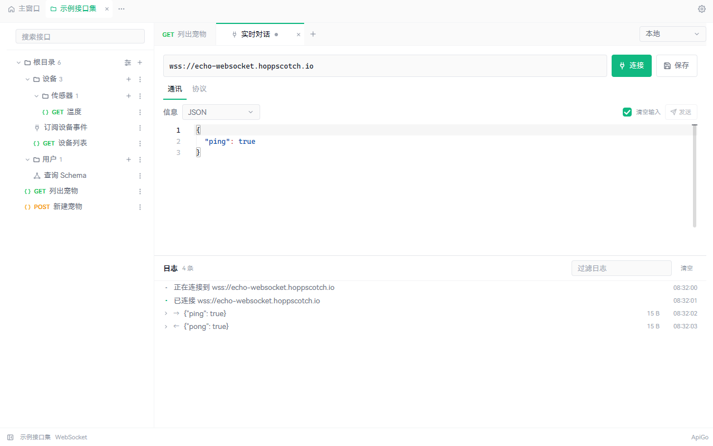 | 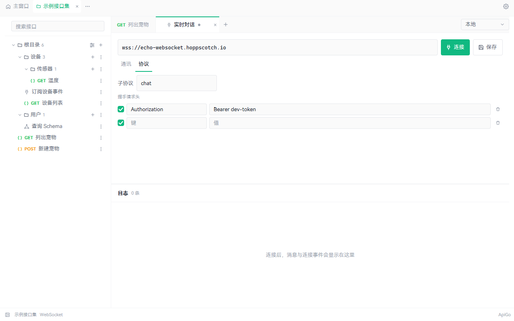 |

| 请求页签的「+」：先选接口类型 | 请求体：先选格式再编辑 |
|---|---|
| 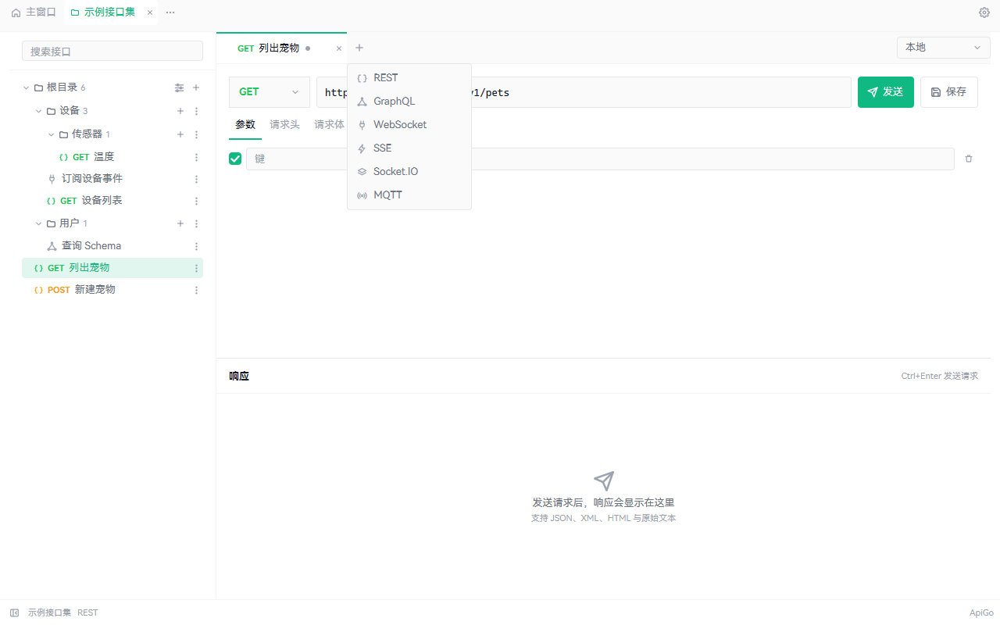 | 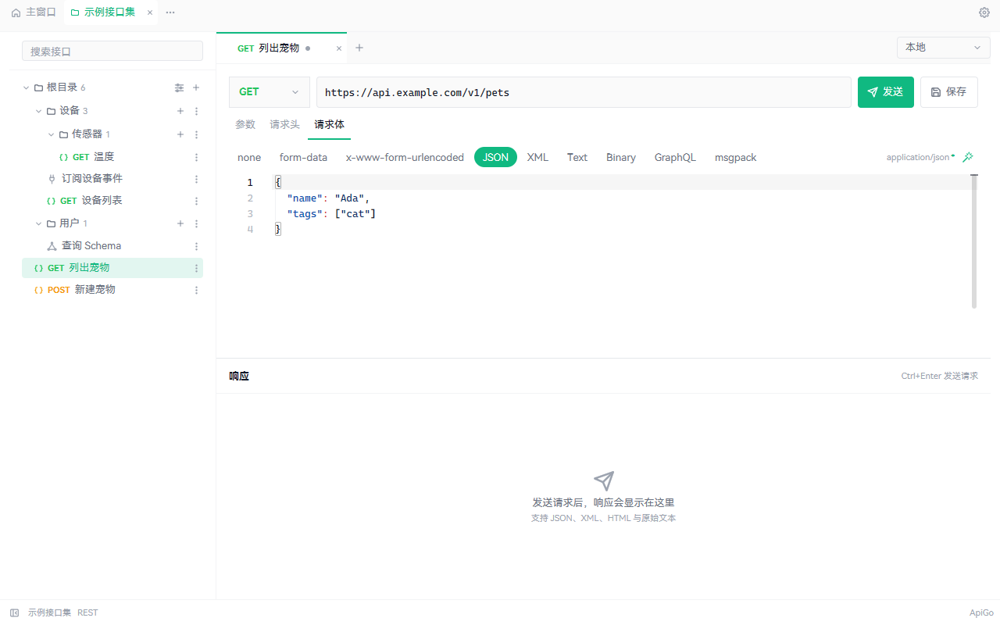 |

| 集合目录被删：灰显 + 中划线，点击先问 | 确认移除 |
|---|---|
| 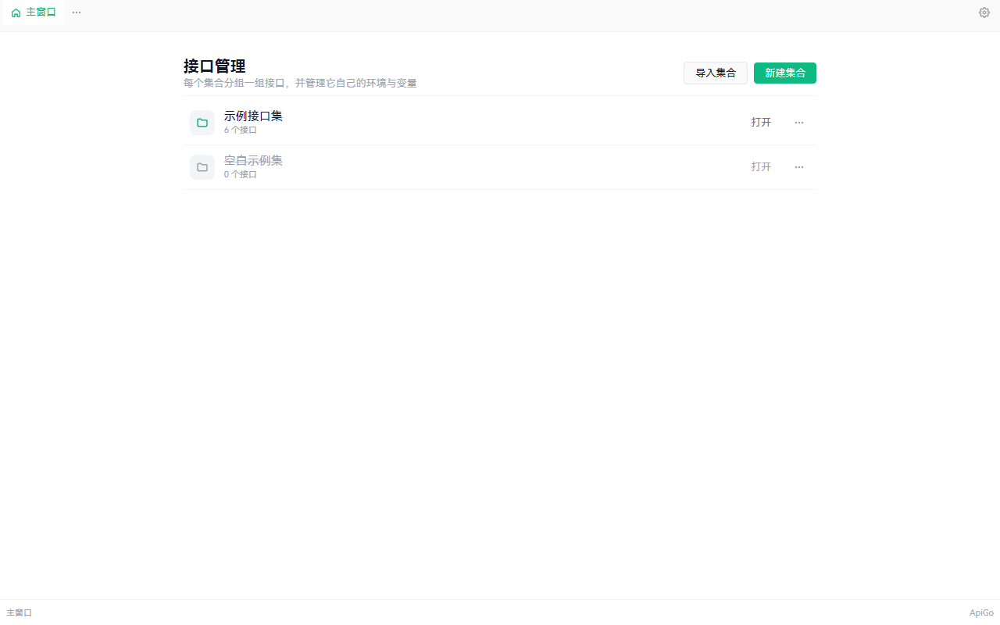 | 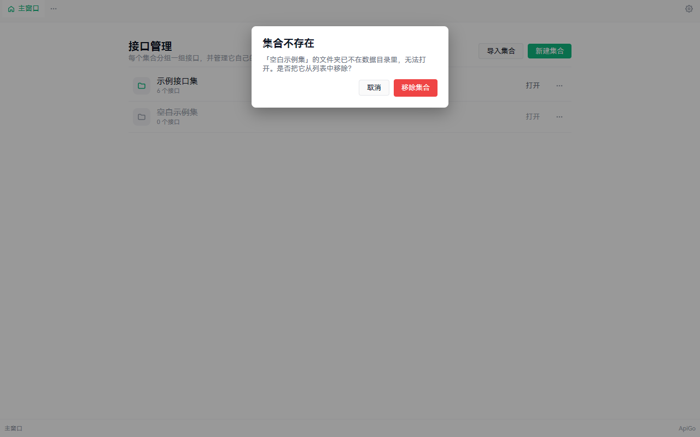 |

<a id="install"></a>
## 📦 安装

> [!NOTE]
> 目前没有发布任何安装包（Releases 为空），开发期请从源码运行。

| 方式 | 命令 | 说明 |
|---|---|---|
| 源码运行（推荐） | `go run .` | 需要 Go 1.27.2 或更高版本 |
| 本地产出可执行文件 | `go tool mygo build` | 产物写入 `mygo.json` 的 `out`（`build/`） |

<a id="start"></a>
## 🚀 快速开始

前置依赖：

| 依赖 | 版本 / 说明 |
|---|---|
| Go | 1.27.2+（`go.mod` 中声明） |
| MyGo CLI | 无需单独安装，`go tool mygo` 直接运行 `go.mod` 里 pin 的 v0.6.0 |
| Task | 3.54.0+，任务入口见 `Taskfile.yml`（`task --list` 查看全部） |

```bash
# 1. 拉取依赖
go mod download

# 2. 启动窗口（native UI，无需前端构建）
task run

# 3. 全量检查：go build/vet + mygo vet + 测试 + 竞态
task check
```

<a id="dev"></a>
## 🛠️ 开发与构建

日常入口是 Task，等价命令一并列出：

| 任务 | 等价命令 | 作用 |
|---|---|---|
| `task dev` | `go tool mygo dev` | 开发模式：改 Go 代码自动重建并重启窗口 |
| `task run` | `go run .` | 直接启动窗口 |
| `task build` | `go build -trimpath -ldflags "-s -w -H=windowsgui" -o bin/apigo.exe .` | 裸可执行文件到 `bin/`（版本号先写入 `mygo.json`，无安装包） |
| `task package` / `task package:windows` | `go tool mygo build -platform windows/amd64` | Windows：exe + NSIS 安装包，输出 `build/windows-amd64/` |
| `task package:darwin` | `go tool mygo build -platform darwin/universal` | macOS 通用包 `.app`（dmg 只能在 macOS 上生成） |
| `task package:linux ARCH=arm64` | `go tool mygo build -platform linux/arm64` | Linux：deb + tar.gz（默认 amd64） |
| `task package:all` | — | 三平台依次打包 |
| `task check` | `go build ./...`、`go vet ./...`、`go tool mygo vet .`、`CGO_ENABLED=0 go test ./...`、`go test -race ./...` | 静态检查 + 测试 + 竞态 |
| `task sync:version APP_VERSION=1.2.3` | `go run ./tools/syncversion -version 1.2.3` | 把版本号写进 `mygo.json`（唯一版本来源） |
| `task doctor` | `go tool mygo doctor` | 检查 MyGo 开发环境 |
| `task clean` | — | 清理 `bin/`、`build/`、`dist/`、`.mygo/` |
| — | `APIGO_SHOTS=docs/shots go test -run TestShots ./internal/app/` | 离屏渲染当前界面的三套外观 PNG，用于布局核验 |

> [!TIP]
> `go tool mygo build` 默认只构建 `windows/amd64`；其他形态直接加参数：`-platform web`（浏览器版 WASM + WebGL 2，输出 `<out>/web`）、`-debug`（保留 Web Inspector）。

Agent 协作规则见 `AGENTS.md`，MyGo 框架实践见 `.agents/skills/mygo-maintenance/SKILL.md`。

### GitHub 工作流

CI 不重复写命令，直接调用 Taskfile（`TASK_VERSION` 固定 3.54.0）：

| 工作流 | 触发 | 内容 |
|---|---|---|
| `Check` | push 到 `main`、所有 PR | `task check`；Windows 作业额外 `task package:windows` 打包冒烟（校验 exe 与 NSIS 安装包） |
| `Package` | 打 `v*` tag、手动触发 | 解析 tag 得到版本号，用 `task package:windows/darwin/linux APP_VERSION=<版本>` 构建三平台；Linux 包靠 `mygo.json` 的 `"linux": {"webview": false}` 只依赖 GTK（不带 WebKitGTK）；附 `.sha256` 校验和；tag 触发时创建/更新 Release |

发布命令序列：

```bash
git tag v0.1.0
git push origin v0.1.0     # 触发 Package，版本号取自 tag（去掉 v 前缀）
```

> [!NOTE]
> 版本号来自 tag 而非 `mygo.json` 当前值：`task sync:version` 会先改写 `mygo.json` 再构建（`mygo build` 没有 `-version` 参数）。macOS 产物未签名（未配置 `macos.signingIdentity`），首次打开需在系统中放行。

<a id="config"></a>
## ⚙️ 配置说明

应用元信息由 `mygo.json` 描述（native UI 项目无需 `mygo.config.ts`）：

| 字段 | 当前值 | 说明 |
|---|---|---|
| `name` | `apigo` | 用户可见的应用名、可执行文件名、安装包名（界面显示名用代码里的 `appName = "ApiGo"`，见 `internal/app/view_footer.go`） |
| `identifier` | `io.github.younland.apigo` | 反向域名，系统据此记录偏好与注册信息；换成自有域名时记得同步 |
| `version` | `0.1.0` | `App.Version()` 返回值，更新比对依据 |
| `copyright` | `© 2026 younland` | 写进 macOS `Info.plist` 与 Windows 文件属性 |
| `out` | `build` | `mygo build` 输出目录 |
| `linux.maintainer` / `linux.comment` | `younland <younland@users.noreply.github.com>` / 一句话简介 | deb 维护者与桌面项/包描述 |
| `linux.webview` | `false` | native UI 不需要 WebView |
| 图标 | `resources/icon.png` | 默认取该路径；建议 1024×1024 方形 PNG |

> [!TIP]
> 主题无需配置：MyGo 跟随桌面亮暗设置，自定义颜色时用 `c.Theme()` 的语义色而非硬编码色值。

<a id="structure"></a>
## 🗂️ 目录结构

```text
apigo/
├── main.go                          # 入口，只有 app.Run()
├── internal/
│   ├── app/                         # 界面与动作（MyGo native UI）
│   │   ├── run.go                   #   窗口创建、数据目录与设置装载、MyGo 接线（App.Run）
│   │   ├── app.go                   #   应用状态：集合工作区、外观、发送（后台 goroutine）/应用响应、请求体格式
│   │   ├── app_tree.go              #   树的动作：保存、移动、删除接口与文件夹，标签的跟随与关闭
│   │   ├── app_watch.go             #   目录监听：跟随外部对集合文件的改动
│   │   ├── store_alias.go           #   集合模型的类型别名（collection/folder/… 指向 internal/store）
│   │   ├── req_alias.go             #   请求模型的类型别名（response/formPart/bodyFormat 指向 internal/req）
│   │   ├── view.go                  #   根布局：集合标签条 / 主窗口或集合工作区 / 状态栏
│   │   ├── view_topbar.go           #   集合标签条：主窗口、集合切换与关闭、最近关闭、设置
│   │   ├── view_home.go             #   主窗口：集合列表、新建/打开/打开文件夹/删除、空状态引导
│   │   ├── view_requests.go         #   左侧接口面板：搜索、接口树、行尾新建菜单与筛选
│   │   ├── view_menu.go             #   自绘 popover 菜单（图标 + 文本，删除项警示色）
│   │   ├── view_confirm.go          #   确认弹窗（顶部居中，危险动作按钮用 Danger 色）
│   │   ├── view_picker.go           #   文件夹选择弹窗：保存接口与移动接口/文件夹共用
│   │   ├── view_tabs.go             #   请求标签页：新建、切换、关闭、右键菜单、环境选择器
│   │   ├── view_kind.go             #   接口类型图标与类型菜单
│   │   ├── view_env.go              #   环境弹窗与设置弹窗（通用/主题/数据三段）
│   │   ├── view_request.go          #   请求行、请求子标签与面板
│   │   ├── view_response.go         #   响应 meta 栏、空/错误状态与四个页签的容器
│   │   ├── view_response_tabs.go    #   预览/原始内容/响应头/请求头页签与两列表头表格
│   │   ├── view_response_media.go   #   图片视图、音频播放器、文件/视频卡（含「保存到下载目录」）
│   │   ├── response_body.go         #   响应分类（text/image/audio/video/file）与下载文件名
│   │   ├── response_media.go        #   图片解码与缓存、播放器生命周期、保存到下载目录
│   │   ├── view_start.go            #   开始提示面板（集合刚打开、没有标签时）
│   │   ├── view_websocket.go        #   WebSocket 面板：地址与连接、通讯/协议页签、消息与日志
│   │   ├── socket.go                #   socket 动作：连接/断开/发送、日志与握手头
│   │   ├── view_footer.go           #   状态栏（集合名、接口类型、版本）
│   │   └── *_test.go                #   ui.NewTester 视图测试 + APIGO_SHOTS 截图（shot_test.go）
│   ├── store/                       # 持久化：集合即目录，接口即 <名字>.yaml
│   │   ├── service_store.go         #   数据目录布局：collections/ 的读写、集合索引、路径
│   │   ├── service_collection.go    #   集合的新建/重命名（连目录）
│   │   ├── service_hidden.go        #   删除集合是伪删除：记进 hidden.yaml，目录留在原处
│   │   ├── service_tree.go          #   接口树与磁盘映射：目录=文件夹、<接口名>.yaml=接口
│   │   ├── service_move.go          #   接口/文件夹的移动（文件或目录跟着搬）与真实删除
│   │   ├── service_reload.go        #   整份重读集合、清理 .tmp 残留
│   │   ├── service_static.go        #   上传文件：复制进 static/<日期>/<sha256>，按字段删除
│   │   ├── service_env.go           #   环境：每个环境一个 .env/<环境>.yaml
│   │   ├── service_settings.go      #   设置的持久化：外观、强调色、语言、响应体上限（settings.yaml）
│   │   ├── service_location.go      #   数据目录的选择：location.yaml 指向用户换过的目录
│   │   ├── service_yaml.go          #   YAML 读写、文件名净化、id 编号
│   │   ├── service_kind.go          #   六种接口类型与它们的显示名
│   │   ├── vars.go                  #   store.VarsFor：活动环境变量的作用域合并
│   │   └── collections_test.go      #   磁盘布局、集合/环境存储与变量合并
│   ├── req/                         # 请求执行与变量解析
│   │   ├── http.go                  #   组请求（URL/参数/头/体）与发送（超时、可配置的响应体上限）
│   │   ├── formats.go               #   九种请求体格式（Key/Label/MIME/编辑方式）
│   │   ├── vars.go                  #   {{variable}} 解析
│   │   ├── http_test.go             #   各格式的 Content-Type 与 payload、上传
│   │   └── vars_test.go             #   变量解析与缺失报告
│   ├── ws/                          # WebSocket 客户端（gorilla/websocket 之上的一层）
│   │   ├── ws.go                    #   Dial/Send/Close 与事件流（Received/Disconnected）
│   │   └── ws_test.go               #   回声、二进制、子协议、关闭、握手被拒
│   ├── widgets/                     # 自绘控件：键值列表（kvlist.go）
│   ├── assets/                      # 内嵌界面字体（HarmonyOS Sans SC + go:embed + 注册）
│   ├── design/                      # 设计令牌：色值、尺寸、字号、方法/状态配色、强调色与主题
│   └── icons/                       # 自绘 SVG 图标（currentColor，24×24）
├── resources/
│   └── icon.png                     # 应用图标（mygo 默认读取该路径）
├── docs/
│   ├── design-baseline.md           # 还原基线：尺寸/色值真相源与已知差异
│   ├── baseline/                    # 目标截图基线（待补充）
│   └── shots/                       # 当前界面的离屏截图（docs/shots）
├── tools/syncversion/               # 把 APP_VERSION 写进 mygo.json（task sync:version 调用）
├── .github/workflows/
│   ├── check.yml                    # CI：静态检查 + 测试 + 竞态 + Windows 打包冒烟
│   └── release.yml                  # tag 触发的三平台打包与 Release
├── LICENSE                          # MIT 协议
├── mygo.json                        # 应用元信息与构建输出目录
├── go.mod                           # 模块 apigo；Go 1.27.2；pin mygo v0.6.0 作为 tool
├── Taskfile.yml                     # 任务入口：dev / build / package:* / check / sync:version
└── .agents/
    ├── skills/mygo-maintenance/ # MyGo 官方维护技能（生命周期/身份/线程/测试）
    ├── readme/SKILL.md          # README 写作规范
    └── commit/SKILL.md          # 提交信息规范
```

### 集合在磁盘上的样子

一个集合就是一个目录，界面里的「根目录」就是它本身（没有同名文件夹），子文件夹与接口各对应真实的目录与文件：

```text
collections/示例接口集/
├── apigo.yaml            # 集合自己的说明与设置：name / description
├── .env/                 # 环境：一个环境一个文件
│   ├── 本地.yaml          # id / name / active / variables
│   ├── 测试.yaml
│   └── 生产.yaml
├── static/               # 上传的文件：static/<日期>/<sha256>（内容相同只存一份）
├── .tmp/                 # 写盘的中转：文件写好后 rename 到位，崩溃残留打开集合时清掉
├── 列出宠物.yaml          # 根目录下的接口 = 集合目录下的文件
├── 新建宠物.yaml
└── 设备/                 # 子文件夹 = 真实目录，可以继续嵌套
    ├── 订阅设备事件.yaml
    └── 设备列表.yaml
```

- 接口文件名就是接口名：改名即改文件名，内容只存方法、URL、参数、请求头与请求体；`bodyType` 记格式，代码类格式的正文在 `body`，两个表单格式的行在 `form` 里——文件字段的行另记 `file`（`static/<日期>/<sha256>` 的相对路径）与 `fileName`（上传时的原始文件名）。
- 环境文件名就是环境名，`active: true` 的是当前环境；改名会跟着改文件名。
- `.env`、`static` 与以 `.` 开头的目录（含 `.tmp`）不是接口文件夹，读取时不监听也不列出；接口文件被外部改名或用编辑器新增后，树表由目录监听（`mygo.WatchFiles`，150ms 去抖）立刻跟着更新。
- 删除集合是**伪删除**：集合目录、接口文件与环境文件都原地保留，只在数据目录根的 `hidden.yaml` 里记下它的目录名，`load()` 读到时就不再列出；想找回就把那行删掉。因为目录还占着名字，用同一个名字新建集合会得到 `<名字>-2` 这样的目录名。

<a id="tech"></a>
## 🧱 技术栈

| 层面 | 选型 |
|---|---|
| 语言 | Go 1.27.2（`go.mod`） |
| UI 框架 | MyGo v0.6.0 的 `ui` 包，native UI 模式（无 HTML/JS，无 WebView） |
| 渲染后端 | 平台 GPU 后端：Windows Direct3D 11 / macOS Metal / Linux OpenGL |
| 打包 | `go tool mygo build`：exe + NSIS 安装包 / `.app`+`.dmg` / deb+tar.gz / WASM |
| 测试 | 标准库 `testing` + `ui.NewTester` 离屏视图测试 |
| 字体 | 内嵌 `resources/HarmonyOS_Sans_SC.ttf`：启动时 `ui.RegisterFont` 注册为 `HarmonyOS Sans SC`，主题 `Font` 默认启用（`design.FontFamily`）；URL/JSON 仍用系统 `monospace`；注册失败回落系统字体（可执行文件因此约 +20 MB）。字号比 Hoppscotch 的采样上一档（正文 13 / 小字 11 / 行高 17）：同一字号下鸿蒙黑体的墨量比系统 UI 字体少约 7%，12 DIP 的正文在灰度抗锯齿下显得过瘦 |
| 网络 | 标准库 `net/http`（REST）+ `github.com/gorilla/websocket`（WebSocket 客户端，纯 Go、无 cgo） |
| 存储 | 本地 YAML（`gopkg.in/yaml.v3`）：一个集合一个目录（`apigo.yaml` + `.env/<环境>.yaml` + `static/` + `<接口名>.yaml`），设置一个文件（`settings.yaml`：外观/强调色/语言/响应体上限/自动更新），删除的集合记在 `hidden.yaml`（伪删除）；`location.yaml` 记着用户换过的数据目录；原子写入 `*.tmp` + rename |
| 数据目录 | 默认 MyGo 用户数据目录（Windows 为 `%APPDATA%\apigo`）下的 `collections/<集合目录>`，可在设置里换成任意目录；换过的位置记在默认目录的 `location.yaml` |
| cgo | 不需要（`CGO_ENABLED=0` 可测可构建） |

<a id="roadmap"></a>
## 🗺️ Roadmap

- [x] M1 应用骨架：顶部集合标签条 / 请求标签条 / 接口面板 / 状态栏
- [ ] M0 设计基线：等待 `docs/baseline/` 截图后逐屏标定尺寸与色值
- [x] M2 请求编辑器：方法下拉、URL、发送、参数/请求头键值表格、Body 编辑器
- [x] M3 响应面板：状态码/耗时/大小、预览（JSON/图像/音频/视频/文件）、原始内容、响应头与请求头表格、下载（JSON 折叠树待补）
- [x] M4 网络执行层：每请求一条 goroutine（网络与重活都在后台）+ `Window.Update` 回主线程、超时、可配置的响应体上限（默认 100 MB）、请求可取消（代理待补）
- [x] M5a 集合工作流：主窗口列表、新建集合（默认三环境 + BaseURL）、六类接口、保存与会话恢复
- [x] M5b 环境与变量：环境增删改激活、`{{name}}` 替换与未解析拒发
- [x] M5c 集合目录化存储：`apigo.yaml` / `.env` / `static` / 每个接口一个文件，树与磁盘一一对应
- [x] M6a 请求多标签：每个集合一组标签，新建/切换/关闭/复制/重命名
- [ ] M6b Ctrl K 命令面板与全局快捷键
- [ ] M7 设置页、缩放回归、无障碍抽查
- [ ] M8 三平台打包与发布、CI 截图产物
- [x] M9 WebSocket：连接/断开、通讯与协议页签、消息格式与收发日志（GraphQL、SSE、Socket.IO、MQTT 仍待实现）
- [ ] M10 集合导入：Postman、在线 Swagger、OpenAPI v2/v3；集合导出；环境变量的全局作用域

<a id="license"></a>
## 📜 开源协议

本项目采用 [MIT 协议](LICENSE)，Copyright (c) 2026 younland。
