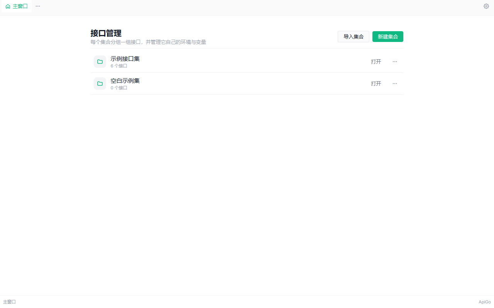
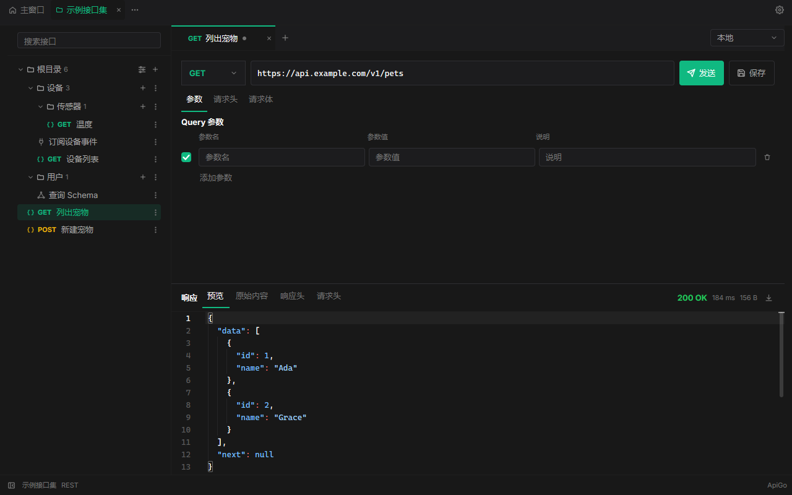
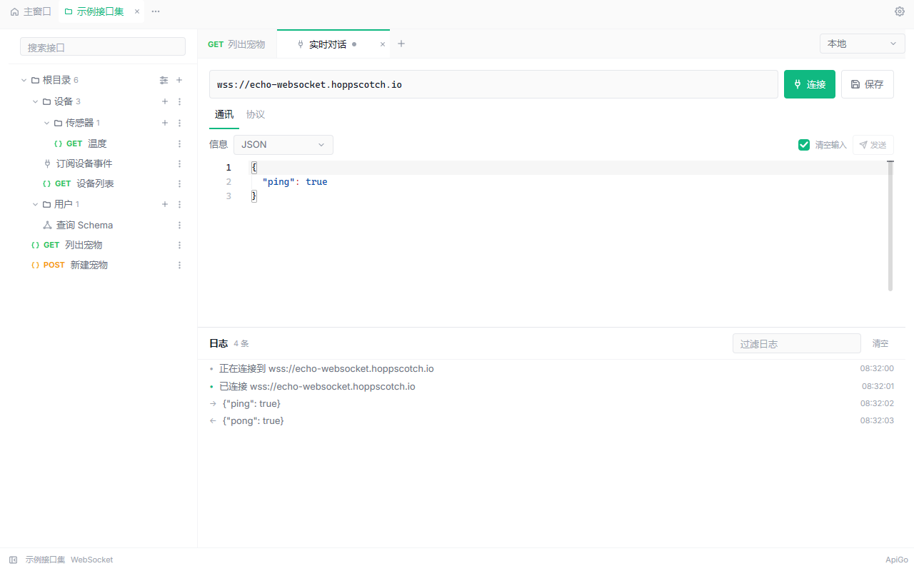
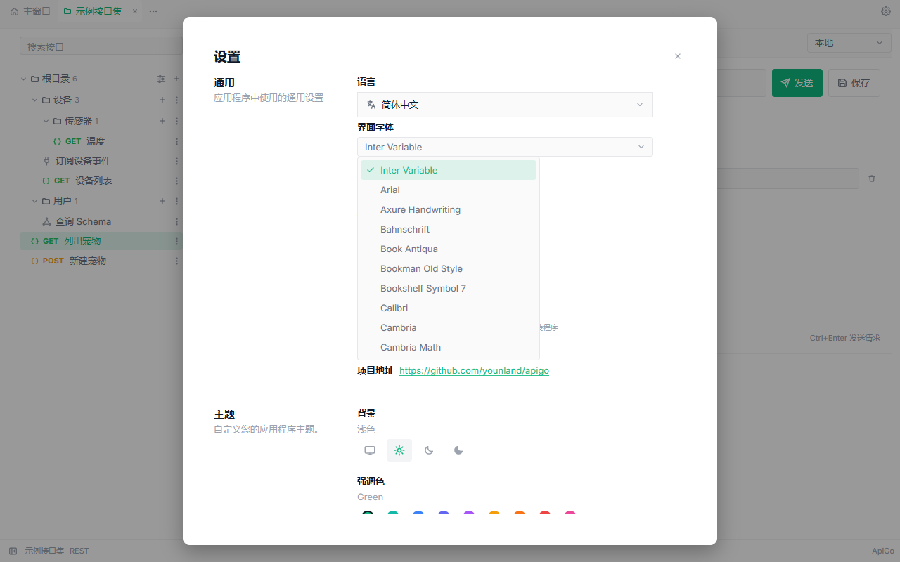

<div align="center">
  
  <h1>ApiGo</h1>
  <p><strong>基于 MyGo 原生 UI 的跨平台接口调试工具</strong></p>
  <p>Go 直接绘制 · 无 HTML/JS/WebView · 单二进制分发 · 本地 YAML 存储</p>
  <p>
    <a href="#tech"></a>
    <a href="#tech"></a>
    <a href="https://github.com/younland/apigo/releases/latest"></a>
    <a href="LICENSE"></a>
  </p>
  <p>
    <a href="#features">核心功能</a> ·
    <a href="#shots">界面截图</a> ·
    <a href="#install">安装</a> ·
    <a href="#start">快速开始</a> ·
    <a href="#dev">开发指南</a> ·
    <a href="#structure">目录结构</a> ·
    <a href="#license">开源协议</a>
  </p>
</div>

<a id="about"></a>
## 📖 项目说明

ApiGo 的界面与逻辑均由 Go 编写，使用 MyGo 原生 UI 渲染，不需要前端构建链或浏览器运行时。工作流以「集合 → 接口」为中心：在集合中管理 REST 与 WebSocket 接口、环境和变量，并将数据保存为本地 YAML 文件。

<a id="features"></a>
## ✨ 核心功能

| 能力 | 说明 |
|---|---|
| 集合与环境 | 集合/文件夹/接口管理、独立请求标签、本地/测试/生产环境、`{{name}}` 变量与 `baseurl` 地址前缀 |
| REST 请求 | 方法与 URL、Query/Path 参数、请求头、JSON/XML/Text、form-data、x-www-form-urlencoded |
| 文件上传 | form-data 文本或文件字段、图片缩略图、上传文件按内容哈希存入集合 |
| 响应查看 | JSON/文本、图片、音频、文件预览，原始内容、响应头/请求头、文件下载 |
| WebSocket | 连接与断开、消息格式、子协议、握手请求头、日志过滤，点击日志在右侧唯一 code 面板查看详情（可伸缩、可关闭） |
| OpenAPI 导入 | OpenAPI 3 / Swagger 2 的 JSON/YAML，从文件、拖拽或 URL 导入，同名集合就地更新 |
| 个性化 | 浅色/深色/纯黑、强调色、界面字体选择，默认 `Inter Variable, sans-serif` |
| 自动更新 | 检查 GitHub Release，后台下载当前平台安装包，校验 SHA-256 后启动安装程序 |

> [!IMPORTANT]
> GraphQL、SSE、Socket.IO、MQTT 目前只能创建接口和打开标签，尚不能执行请求。

<a id="shots"></a>
## 📸 界面截图

| 集合列表 | 请求与 JSON 响应 |
|---|---|
|  |  |

| WebSocket 消息与日志 | 设置与界面字体 |
|---|---|
|  |  |

截图由 `ui.NewTester` 离屏渲染生成，全部保存在 `docs/shots/`。

<a id="install"></a>
## 📦 安装

从 [GitHub Releases](https://github.com/younland/apigo/releases/latest) 下载对应平台产物：

| 平台 | 产物 |
|---|---|
| Windows | `apigo-<版本>-windows-amd64-setup.exe`（安装包）或 `-portable.exe`（便携版） |
| macOS | `apigo-<版本>-darwin-universal.dmg`（通用包，未签名） |
| Linux | `apigo-<版本>-linux-<架构>.deb` 或 `.tar.gz`（amd64 / arm64） |

也可以直接从源码运行：

```bash
go mod download
go run .
```

<a id="start"></a>
## 🚀 快速开始

| 依赖 | 版本 / 说明 |
|---|---|
| Go | 1.27.3+ |
| MyGo CLI | 无需单独安装，`go tool mygo` 使用 `go.mod` 中固定的 v0.7.1 |
| Task | 3.54.0+，日常任务入口 |

```bash
# 启动应用
task run

# 开发模式：代码变化后自动重建并重启
task dev

# 全量检查：构建、vet、MyGo vet、测试和竞态检测
task check
```

<a id="dev"></a>
## 🛠️ 开发指南

| 命令 | 用途 |
|---|---|
| `task build` | 构建裸可执行文件到 `bin/` |
| `task package:windows` | Windows exe 与 NSIS 安装包 |
| `task package:darwin` | macOS 通用 `.app`；DMG 只能在 macOS 上生成 |
| `task package:linux ARCH=arm64` | Linux deb 与 tar.gz，默认架构为 amd64 |
| `task sync:version APP_VERSION=1.2.3` | 将版本号写入 `mygo.json` |
| `task doctor` | 检查 MyGo 开发环境 |
| `task clean` | 清理构建产物 |

重新生成界面截图：

```bash
APIGO_SHOTS=docs/shots go test -run TestShots ./internal/app/
```

推送 `v*` 标签会触发 `Package` 工作流，构建三平台产物、生成 SHA-256 校验文件并创建 Release。Agent 协作规则见 `AGENTS.md`，MyGo 维护实践见 `.agents/skills/mygo-maintenance/SKILL.md`。

<a id="config"></a>
## ⚙️ 配置与数据

| 项目 | 说明 |
|---|---|
| `mygo.json` | 应用名、标识、版本、构建输出目录和 Linux 打包配置 |
| 数据目录 | 默认位于系统用户配置目录的 `apigo/`，可在设置中更换 |
| 集合 | `collections/<集合>/apigo.yaml`、接口 YAML、`.env/` 与 `static/` |
| 设置 | `settings.yaml` 保存外观、强调色、语言、界面字体、请求限制和更新选项 |

<a id="structure"></a>
## 🗂️ 目录结构

```text
apigo/
├── main.go                  # 应用入口
├── internal/
│   ├── app/                 # 界面、交互与更新流程
│   ├── store/               # 集合、环境、设置与 YAML 持久化
│   ├── req/                 # REST 请求构建、执行与变量解析
│   ├── ws/                  # WebSocket 协议层
│   ├── openapi/             # OpenAPI / Swagger 解析
│   ├── widgets/             # 键值表与参数表控件
│   ├── assets/              # Inter Variable 字体与许可证
│   ├── design/              # 主题、字体和设计令牌
│   └── icons/               # SVG 图标
├── resources/icon.png       # 应用图标
├── docs/                    # 设计基线与界面截图
├── tools/syncversion/       # 版本写入工具
├── .github/workflows/       # 检查与发布工作流
├── .agents/                 # 仓库维护技能与规范
├── go.mod                   # Go 与 MyGo 版本
├── mygo.json                # 应用与打包配置
└── Taskfile.yml             # 开发、检查、构建和发布任务
```

<a id="tech"></a>
## 🧱 技术栈

| 层面 | 选型 |
|---|---|
| 语言 | Go 1.27.3 |
| UI | MyGo v0.7.1 native UI，平台 GPU 渲染 |
| 网络 | 标准库 `net/http`、`github.com/gorilla/websocket` |
| 存储 | `gopkg.in/yaml.v3`，本地目录与 YAML 文件 |
| 字体 | Inter 4.1 + sans-serif 回退，SIL OFL 1.1 |
| 测试 | 标准库 `testing`、`ui.NewTester`、race 检测 |

<a id="roadmap"></a>
## 🗺️ 后续计划

- GraphQL、SSE、Socket.IO、MQTT 请求执行
- 命令面板与全局快捷键
- Postman 集合导入、集合导出

<a id="license"></a>
## 📜 开源协议

本项目采用 [MIT 协议](LICENSE)，Copyright (c) 2026 younland。

Inter 字体使用 SIL Open Font License 1.1，许可证见 `internal/assets/Inter-LICENSE.txt`。
